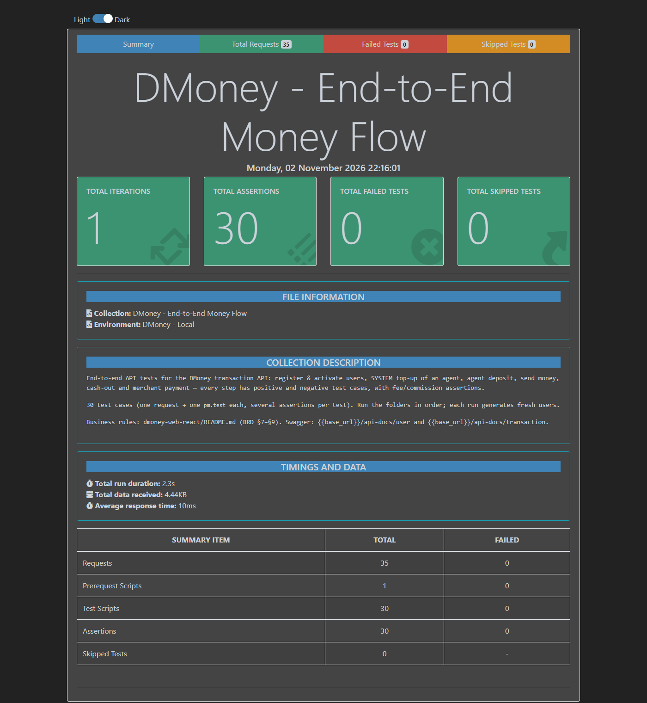
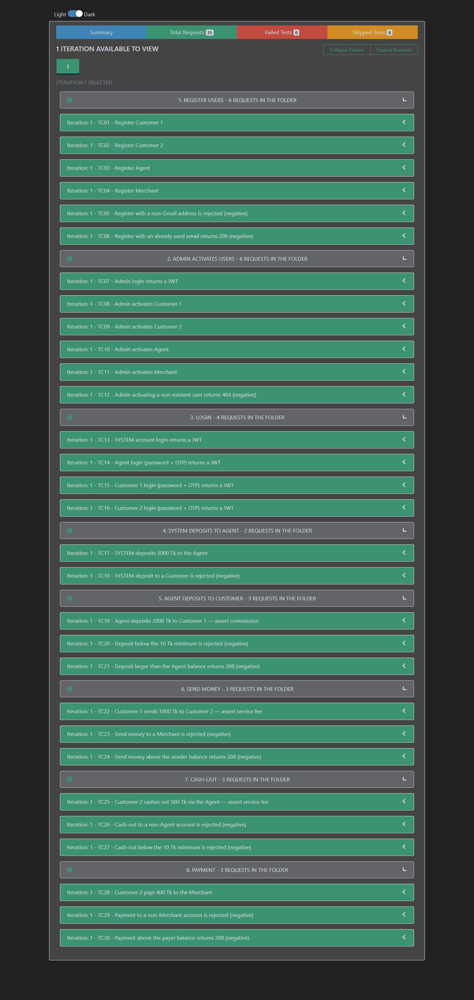

# DMoney API — End-to-End Postman Tests

Postman collection + Newman runner that exercises the full DMoney money flow against the
[`dmoney-transaction-api`](../dmoney-transaction-api) — registering users, activating them as Admin, topping up an
agent from the SYSTEM account, and moving money with deposit, send-money, cash-out and payment — with
fee/commission assertions and negative cases.

| | |
|---|---|
| **Test cases** | 30 (18 positive, 12 negative) — one request and one `pm.test` each, several assertions per test |
| **Collection** | [`postman/DMoney-E2E.postman_collection.json`](postman/DMoney-E2E.postman_collection.json) |
| **Environment** | [`postman/DMoney-Local.postman_environment.json`](postman/DMoney-Local.postman_environment.json) |
| **API documentation** | [`docs/API_DOCUMENTATION.md`](docs/API_DOCUMENTATION.md) — every endpoint, request and a real response |
| **Swagger UI** (served by the API) | <http://localhost:5000/api-docs/user> · <http://localhost:5000/api-docs/transaction> |
| **Business rules** | [`dmoney-web-react/README.md`](../dmoney-web-react/README.md) (BRD §7–§9) |

## The scenario — every step has positive and negative cases

| # | Flow step | Positive (asserted) | Negative (asserted) |
|---|---|---|---|
| 1 | Register 2 customers, 1 agent, 1 merchant | TC01–TC04: 201, status `pending`, no password echoed | TC05 non-Gmail email → 400 · TC06 duplicate email → 208 |
| 2 | Admin activates the 4 users | TC07 admin login · TC08–TC11: 200, status `active` | TC12 unknown user id → 404 |
| 3 | Log in (SYSTEM, agent, customer 1, customer 2) | TC13–TC16: JWT; agent and customers via password + OTP | — (see note below the table) |
| 4 | SYSTEM (`system@dmoney.com`) deposits **5000** Tk to the agent | TC17: agent balance = 5000 | TC18 SYSTEM → Customer → 400 |
| 5 | Agent deposits **2000** Tk to customer 1 | TC19: **commission = 50** (2.5%), agent balance = 3050 | TC20 below 10 Tk minimum → 400 · TC21 more than agent balance → 208 |
| 6 | Customer 1 sends **1000** Tk to customer 2 | TC22: **fee = 5** (flat), sender balance = 995 | TC23 recipient is a Merchant → 400 · TC24 more than balance → 208 |
| 7 | Customer 2 cashes out **500** Tk via the agent | TC25: **fee = 5**, balance = 495, agent balance = 3562.5 (500 + 2.5% commission) | TC26 recipient is not an Agent → 400 · TC27 below 10 Tk minimum → 400 |
| 8 | Customer 2 pays **400** Tk to the merchant | TC28: fee = 5, balance = 90, merchant received ≥ 400 | TC29 recipient is not a Merchant → 400 · TC30 more than balance → 208 |

Not covered, to stay inside the 30-case limit: wrong password on login, wrong `X-AUTH-SECRET-KEY`, and a token used on another
user's account. An earlier version of the collection had these; they are easy to swap back in.

## Test cases

Click an ID for the request, description and example response.

| ID | Test case | Type | Expected status |
|---|---|---|---|
| [TC01](docs/API_DOCUMENTATION.md#tc01---register-customer-1) | Register Customer 1 | Positive | 201 |
| [TC02](docs/API_DOCUMENTATION.md#tc02---register-customer-2) | Register Customer 2 | Positive | 201 |
| [TC03](docs/API_DOCUMENTATION.md#tc03---register-agent) | Register Agent | Positive | 201 |
| [TC04](docs/API_DOCUMENTATION.md#tc04---register-merchant) | Register Merchant | Positive | 201 |
| [TC05](docs/API_DOCUMENTATION.md#tc05---register-with-a-non-gmail-address-is-rejected-negative) | Register with a non-Gmail address is rejected | Negative | 400 |
| [TC06](docs/API_DOCUMENTATION.md#tc06---register-with-an-already-used-email-returns-208-negative) | Register with an already used email returns 208 | Negative | 208 |
| [TC07](docs/API_DOCUMENTATION.md#tc07---admin-login-returns-a-jwt) | Admin login returns a JWT | Positive | 200 |
| [TC08](docs/API_DOCUMENTATION.md#tc08---admin-activates-customer-1) | Admin activates Customer 1 | Positive | 200 |
| [TC09](docs/API_DOCUMENTATION.md#tc09---admin-activates-customer-2) | Admin activates Customer 2 | Positive | 200 |
| [TC10](docs/API_DOCUMENTATION.md#tc10---admin-activates-agent) | Admin activates Agent | Positive | 200 |
| [TC11](docs/API_DOCUMENTATION.md#tc11---admin-activates-merchant) | Admin activates Merchant | Positive | 200 |
| [TC12](docs/API_DOCUMENTATION.md#tc12---admin-activating-a-non-existent-user-returns-404-negative) | Admin activating a non-existent user returns 404 | Negative | 404 |
| [TC13](docs/API_DOCUMENTATION.md#tc13---system-account-login-returns-a-jwt) | SYSTEM account login returns a JWT | Positive | 200 |
| [TC14](docs/API_DOCUMENTATION.md#tc14---agent-login-password--otp-returns-a-jwt) | Agent login (password + OTP) returns a JWT | Positive | 200 |
| [TC15](docs/API_DOCUMENTATION.md#tc15---customer-1-login-password--otp-returns-a-jwt) | Customer 1 login (password + OTP) returns a JWT | Positive | 200 |
| [TC16](docs/API_DOCUMENTATION.md#tc16---customer-2-login-password--otp-returns-a-jwt) | Customer 2 login (password + OTP) returns a JWT | Positive | 200 |
| [TC17](docs/API_DOCUMENTATION.md#tc17---system-deposits-5000-tk-to-the-agent) | SYSTEM deposits 5000 Tk to the Agent | Positive | 201 |
| [TC18](docs/API_DOCUMENTATION.md#tc18---system-deposit-to-a-customer-is-rejected-negative) | SYSTEM deposit to a Customer is rejected | Negative | 400 |
| [TC19](docs/API_DOCUMENTATION.md#tc19---agent-deposits-2000-tk-to-customer-1--assert-commission) | Agent deposits 2000 Tk to Customer 1 — assert commission | Positive | 201 |
| [TC20](docs/API_DOCUMENTATION.md#tc20---deposit-below-the-10-tk-minimum-is-rejected-negative) | Deposit below the 10 Tk minimum is rejected | Negative | 400 |
| [TC21](docs/API_DOCUMENTATION.md#tc21---deposit-larger-than-the-agent-balance-returns-208-negative) | Deposit larger than the Agent balance returns 208 | Negative | 208 |
| [TC22](docs/API_DOCUMENTATION.md#tc22---customer-1-sends-1000-tk-to-customer-2--assert-service-fee) | Customer 1 sends 1000 Tk to Customer 2 — assert service fee | Positive | 201 |
| [TC23](docs/API_DOCUMENTATION.md#tc23---send-money-to-a-merchant-is-rejected-negative) | Send money to a Merchant is rejected | Negative | 400 |
| [TC24](docs/API_DOCUMENTATION.md#tc24---send-money-above-the-sender-balance-returns-208-negative) | Send money above the sender balance returns 208 | Negative | 208 |
| [TC25](docs/API_DOCUMENTATION.md#tc25---customer-2-cashes-out-500-tk-via-the-agent--assert-service-fee) | Customer 2 cashes out 500 Tk via the Agent — assert service fee | Positive | 201 |
| [TC26](docs/API_DOCUMENTATION.md#tc26---cash-out-to-a-non-agent-account-is-rejected-negative) | Cash-out to a non-Agent account is rejected | Negative | 400 |
| [TC27](docs/API_DOCUMENTATION.md#tc27---cash-out-below-the-10-tk-minimum-is-rejected-negative) | Cash-out below the 10 Tk minimum is rejected | Negative | 400 |
| [TC28](docs/API_DOCUMENTATION.md#tc28---customer-2-pays-400-tk-to-the-merchant) | Customer 2 pays 400 Tk to the Merchant | Positive | 201 |
| [TC29](docs/API_DOCUMENTATION.md#tc29---payment-to-a-non-merchant-account-is-rejected-negative) | Payment to a non-Merchant account is rejected | Negative | 400 |
| [TC30](docs/API_DOCUMENTATION.md#tc30---payment-above-the-payer-balance-returns-208-negative) | Payment above the payer balance returns 208 | Negative | 208 |

## Run it

**Prerequisites:** Node.js 18+, and the DMoney API from
[salmansrabon/dmoney-transaction-api](https://github.com/salmansrabon/dmoney-transaction-api) running (MySQL + `npm start` in `dmoney-transaction-api`, or its
`docker compose up -d --build`) on <http://localhost:5000>.

```bash
npm install
cp .env.example .env     # adjust only if your API runs elsewhere / uses other keys
npm test                 # Newman: CLI output + Reports/newman-report.html + Reports/newman-report.json
npm run docs             # (optional) refresh docs/API_DOCUMENTATION.md from the last run
```

`npm test` exits non-zero if any test fails, so it can gate CI.

**In Postman instead:** import the collection (and, optionally, the environment), start the API, and run the collection in
order. The collection carries default values (`base_url = http://localhost:5000`, partner key, seeded logins), so it works even
if no environment is selected; select *DMoney - Local* only to override them. Every run generates fresh users, so it can be
repeated without clearing the database.

### Configuration (`.env`)

`.env` is git-ignored; [`.env.example`](.env.example) lists every variable. Values override the defaults in the Postman environment file.

| Variable | Default | Must match |
|---|---|---|
| `BASE_URL` | `http://localhost:5000` | where the API listens |
| `PARTNER_KEY` | `ROADTOSDET` | API `PARTNER_KEY` (sent as `X-AUTH-SECRET-KEY`) |
| `DEFAULT_OTP` | `0000` | API `DEFAULT_OTP` |
| `ADMIN_EMAIL` / `ADMIN_PASSWORD` | `admin@dmoney.com` / `1234` | seeded admin |
| `SYSTEM_EMAIL` / `SYSTEM_PASSWORD` | `system@dmoney.com` / `1234` | seeded SYSTEM account |
| `USER_PASSWORD` | `1234` | password given to the registered users |

## Newman report

Latest run: **30 test cases, 30 assertions, 0 failed** (generated with `newman-reporter-htmlextra`; the full HTML report is
written to `Reports/newman-report.html`, which is git-ignored).





## How it works

- **Fresh data every run.** TC01's pre-request script generates unique Gmail addresses (the API only accepts `@gmail.com`),
  11-digit phone numbers and NIDs, so reruns never collide with earlier users.
- **OTP login.** Customers, agents and merchants need an OTP that is only emailed or logged by the server. The collection
  uses the API's documented dev bypass — `POST /user/verify-otp?env=dev` with `DEFAULT_OTP` — so no mailbox is needed.
  Admin and SYSTEM log in without OTP.
- **Two-step checks stay one test case.** TC14–TC16 (password + OTP) and the balance lookups inside TC25 and TC28 use
  `pm.sendRequest` from the test script, so each is still one request and one `pm.test`. Newman's summary therefore reports
  *35 requests* (30 collection items + 5 helper calls) while the collection has exactly 30 test cases.
- **Chained state.** Tokens and user ids are stored in collection variables by earlier tests and
  reused later, so run the requests in order.
- **Expected fees come from variables** (`deposit_commission_rate`, `sendmoney_fee`, …) holding the BRD §9 rules, so a
  rule change is a one-line edit instead of an edit in every test.
- The registration emails are sent to the generated Gmail addresses only if the API has working mail credentials; a mail
  failure never fails the request.

## Observations about the API under test

Found while building the suite. Neither is asserted as a failure here, so the suite stays green against the current build.

1. **Merchant commission is not paid.** BRD §7.4 / §9 say the merchant is credited `amount + 2.5%` on a payment
   (410 for a 400 Tk payment). `payment.controller.js` credits only the amount, so the merchant ends with exactly 400.
   TC28 therefore asserts `balance >= 400`; tighten it to 410 once the behaviour is settled.
2. **User lookups leak credentials.** `GET /user/search/phonenumber/:phone` (and the other `/user/search/*` and `/user/list`
   lookups, which need only a JWT) return the full user row — including the unsalted password hash, `otp` and
   `reset_token`. TC28 reads this endpoint for the merchant balance; an assertion that the response has no `password` field would currently fail. The captured
   examples in the docs have the hash redacted.

## Repository layout

```
postman/            collection + environment (the deliverable)
scripts/            run-newman.js (runner) · generate-docs.js (API docs)
docs/               API_DOCUMENTATION.md · images/ (report screenshots)
Reports/            Newman HTML/JSON output        (git-ignored)
.env                local configuration            (git-ignored)
node_modules/                                      (git-ignored)
```
